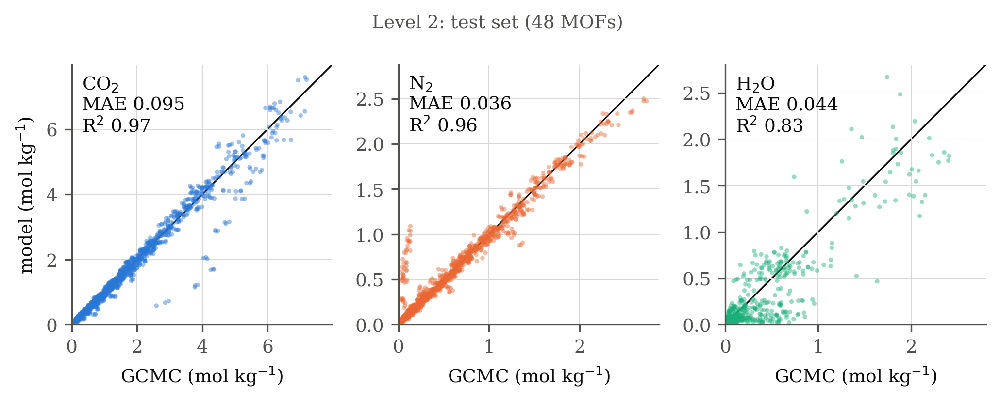
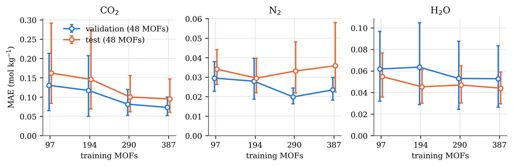
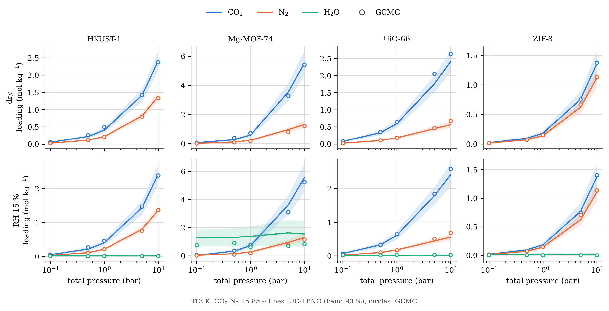
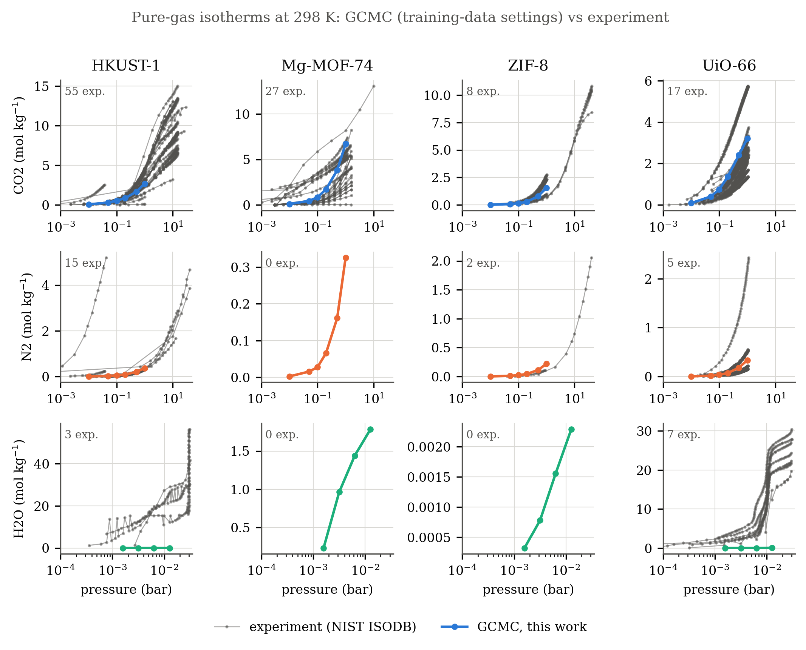

# UC-TPNO: humid CO₂ capture in MOFs

**Uncertainty-Calibrated Thermodynamic Potential Neural Operator** for CO₂/N₂/H₂O
co-adsorption in metal–organic frameworks (MOFs) under humid flue-gas conditions.


The pipeline screens MOFs with grand canonical Monte Carlo (GCMC) simulations and
trains a neural operator that predicts mixture loadings of CO₂, N₂ and H₂O as a
function of temperature, pressure and relative humidity. The model is
thermodynamically consistent **by construction**: loadings are derivatives of one
learned convex potential, so Maxwell symmetry and stability hold exactly.

---

## Method in short

| Step | What happens | Script |
|---|---|---|
| 1. Data | CoRE-MOF 2019 + ARC-MOF CIFs; WS24 water-stability filter; sanitise | `scripts/01_download_data.sh`, `scripts/02_preprocess_all.py` |
| 2. Charges | PACMAN / REPEAT framework partial charges | `scripts/assign_charges.py` |
| 3. Graphs | Periodic crystal graphs with per-atom charges | `scripts/03_generate_graphs.py` |
| 4. GCMC | RASPA2, UFF + TraPPE + TIP4P/2005, framework charges on | `scripts/04_run_simulations.py`, `scripts/run_parallel_gcmc.sh` |
| 5. Train | UC-TPNO ensemble | `scripts/05_train_model.py` |
| 6. Validate | 4-level validation (below) | `scripts/validation/` |

**GCMC stages**

- **Stage 1 (screening):** single-component CO₂, N₂ (0.1/1/10 bar) and H₂O (RH 5/15 %) at 313 K for ~960 MOFs.
- **Stage 2 (selection):** water-aware Pareto + diversity selection (after Kancharlapalli & Snurr 2023).
- **Stage 3 (training labels):** humid multicomponent GCMC, 15:85 CO₂:N₂, 3 T (298/313/333 K) × 5 P (0.1–10 bar) × 3 RH (0/5/15 %) = 45 conditions per MOF. 483 MOFs, 21 735 labelled points.

**Model**

- NequIP-style equivariant encoder (crystal graph + charges) + 12 composition descriptors + 12 per-MOF features (Stage 1 GCMC loadings and charge statistics, a multi-fidelity input).
- Input-convex neural network (ICNN) potential Φ(μ; MOF, T) with FiLM temperature conditioning.
- Loadings n_i = c · ∂Φ/∂μ_i, so ∂n_i/∂μ_j = ∂n_j/∂μ_i (Maxwell) and the Jacobian is positive semi-definite (stability).
- Deep ensemble of 4 members; Huber data loss weighted by GCMC error bars; variance head trained with a stop-gradient NLL; uncertainty calibrated with split conformal prediction.

---

## Results (model run_014)

Data split by framework: 387 train / 48 validation / 48 test MOFs. The test set was evaluated once, after all choices were fixed.

### Accuracy on unseen MOFs (mol/kg)

| Set | CO₂ MAE | CO₂ R² | N₂ MAE | N₂ R² | H₂O MAE | H₂O R² |
|---|---|---|---|---|---|---|
| Validation (48 MOFs) | 0.073 | 0.985 | 0.023 | 0.992 | 0.053 | 0.81 |
| **Test (48 MOFs)** | **0.095** | **0.971** | **0.036** | **0.963** | **0.044** | **0.83** |
| Level 3: 30 new MOFs, new GCMC | 0.270 | 0.90 | 0.084 | 0.94 | 0.561 | 0.63 |



### Screening good MOFs (test set)

A MOF is "good" if, at 313 K, 1 bar and RH 15 %, CO₂ uptake ≥ 1.0 mol/kg and
CO₂(humid)/CO₂(dry) ≥ 0.9. The rule was fixed before the test set was evaluated
(`results/validation/level2/good_mof_definition.json`).

| TP | FP | FN | TN | Precision | Recall | MCC |
|---|---|---|---|---|---|---|
| 11 | 1 | 0 | 36 | 0.92 | 1.00 | 0.94 |

### Uncertainty (90 % intervals, framework-level conformal calibration)

| Set | CO₂ | N₂ | H₂O |
|---|---|---|---|
| Test coverage | 0.95 | 0.92 | 0.95 |
| Level 3 coverage | 0.91 | 0.88 | 0.84 |

### Physics (validation set)

Maxwell asymmetry ≤ 1e-7 (exact up to float precision); positive semi-definite
Jacobian at 100 % of conditions; self-response ∂n_i/∂μ_i ≥ 0 at 100 %.

### Comparison with baselines (same inputs)

| Model | Test CO₂ R² | Test H₂O R² | Val H₂O R² | Level 3 N₂ R² | Thermodynamic guarantees |
|---|---|---|---|---|---|
| **UC-TPNO** | 0.971 | 0.834 | **0.81** | **0.94** | yes, exact |
| Gradient boosting | **0.982** | 0.822 | 0.27 | 0.74 | no |
| Ridge (quadratic) | — | — | 0.23 | — | no |

Gradient boosting is as accurate as UC-TPNO for CO₂ on the test set. UC-TPNO is
clearly better for water on the validation set and for N₂ on new MOFs, and it is
the only model that is thermodynamically consistent by construction.

### Learning curve

Same model and settings trained on nested subsets of the training MOFs
(error bars: 90 % bootstrap over test/validation MOFs).

| Training MOFs | Test CO₂ MAE | Test N₂ MAE | Test H₂O MAE | Test CO₂ R² | Val H₂O R² |
|---|---|---|---|---|---|
| 97 (25 %) | 0.162 | 0.034 | 0.055 | 0.885 | 0.65 |
| 194 (50 %) | 0.146 | 0.030 | 0.045 | 0.890 | 0.57 |
| 290 (75 %) | 0.100 | 0.033 | 0.047 | 0.967 | 0.72 |
| 387 (100 %) | 0.095 | 0.036 | 0.044 | 0.971 | 0.81 |

CO₂ error falls by about 40 % from 97 to 387 MOFs and starts to level off; N₂
is already accurate with 97 MOFs. Water error changes little within the
uncertainty, consistent with water being limited by the range of water
affinities in the training set rather than by the number of MOFs.



### Level 4: reference MOFs vs experiment

For HKUST-1, Mg-MOF-74, UiO-66 and ZIF-8 (not in training) the model reproduces
the humid GCMC closely (CO₂ MAE 0.03–0.11 mol/kg).



Against NIST experimental isotherms (298 K), the GCMC itself gives:

- CO₂: within the experimental range for HKUST-1 and UiO-66; too low at low pressure for Mg-MOF-74 (open metal sites are not described by UFF).
- N₂: within a factor of about 2.
- **H₂O: 100–1000× below experiment** for HKUST-1 and UiO-66.



---

## Limitations

1. **Water is underestimated by the force field** (UFF + TIP4P/2005 with predicted
   charges). The model reproduces the simulations, so it inherits this error;
   absolute water uptakes should not be read as experimental values.
2. Open-metal-site CO₂ binding is underestimated (e.g. Mg-MOF-74).
3. Humidity covers RH ≤ 15 % only.
4. Strong water adsorbers are rare in training (Stage 2 selection bias), so water
   is underpredicted for very hydrophilic new MOFs (Level 3).

---

## Validation levels

| Level | Question | Results |
|---|---|---|
| 1 | Are the GCMC labels sensible? (error bars, CRAFTED, Kancharlapalli & Snurr 2023, IAST) | `results/validation/level1/` |
| 2 | Does the model generalise to unseen MOFs? (validation/test, UQ, physics, baselines, screening) | `results/validation/level2/`, `uq/`, `baselines/` |
| 3 | Does it hold for new frameworks with fresh GCMC? | `results/validation/level3/` |
| 4 | How do simulations and model compare with experiment? | `results/validation/level4/` |

---

## Setup and usage

```bash
python -m venv thesis_env
source thesis_env/bin/activate
pip install -r requirements.txt
```

RASPA2 must be installed separately for the GCMC steps; the force fields are in `forcefields/`.

Train:

```bash
python scripts/05_train_model.py \
    --registry data/mof_registry.parquet \
    --adsorption-data data/processed/adsorption_v3/adsorption_training.parquet \
    --graph-dir data/processed/graphs \
    --output-dir experiments/run_014 --amp
```

`--train-fraction 0.5` trains on a nested subset of the training MOFs (learning curve).

Predict and evaluate a split:

```bash
python scripts/validation/predict_split.py \
    --checkpoint experiments/run_014/checkpoints/best_model.pt \
    --splits experiments/run_014/splits.json --split test \
    --out results/validation/level2/run_014_test_predictions.csv
python scripts/validation/evaluate_predictions.py \
    --pred results/validation/level2/run_014_test_predictions.csv \
    --label "test set (48 MOFs)" --out results/validation/level2/run_014_test
```

Other validation scripts in `scripts/validation/`: `conformal_calibration.py`,
`physics_checks.py`, `baseline_models.py`, `confusion_matrix.py`,
`level1_data_validation.py`, `level4_nist_comparison.py`,
`level4_model_comparison.py`.

Configuration: `configs/pipeline.yaml`.

## Repository layout

```
configs/      pipeline configuration
forcefields/  RASPA force-field files
scripts/      pipeline steps (01–10) and validation/
src/          data, models (encoder, operator, UQ), simulation, training, evaluation
tests/        unit tests (operator physics, GCMC I/O)
results/      validation figures and tables
```

Large data (CIFs, graphs, GCMC outputs) and trained checkpoints are not in the repository.
